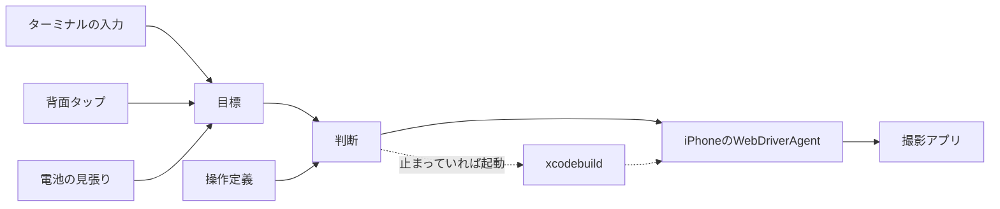

# 仕組み

`field-app`がiPhoneをどう操作しているかを、プログラムを読む前に把握するための説明です。部品ごとの分担は[`mac/controller-core/README.md`](../mac/controller-core/README.md)にあります。

## 全体の形

Macでは、iPhone 1台につき`field-app`を1つ動かします。`field-app`は、そのiPhoneで動くWebDriverAgentとHTTPで話し、画面の部品を読んで、ボタンを押します。WebDriverAgentは、AppleのUIテストの仕組み（XCUITest）の上で動くHTTPサーバーのアプリで、`field-app`がMacの`xcodebuild`で起動します。

1台のiPhoneを操作するのは、そのiPhoneの`field-app`だけです。1台が止まっても、ほかのiPhoneの`field-app`は動き続けます。

## 指示と目標

`field-app`への指示は、「撮影を続ける」（`running`）か「止める」（`paused`）のどちらかの目標として記録します。指示の出どころは三つで、どれも同じ目標を書き換えます。新しい指示が来ると、前の指示は上書きされます。

- ターミナルへの入力
- 背面タップのショートカットからのHTTPの要求
- 電池の見張り。充電していない間に、決めた残量まで減ると、止める指示を出す

起動した直後は目標がなく、最初の指示が来るまで画面を読むだけです。止める目標に着いたあとも、次の指示が来るまで画面を読むだけです。休憩中に人がiPhoneを使っても、そのままにしておきます。

目標は、変わるたびにMacのディスクに残します。撮影を続けている間に`field-app`が落ちたときは、起動し直した`field-app`がそれを引き継ぎます。ふつうに終了するときは、止めた画面まで進めてから`paused`を残すので、次の起動では引き継ぎません。

## 操作定義

操作定義は、撮影アプリごとのJSONで、アプリの画面とボタンの地図です。

- 状態: 画面の見分け方。どの部品があり、どの部品がないか
- 操作: どの状態で、どのボタンを押すと、どの状態へ移るか
- アプリが自分で進む移り変わり: カウントダウンが終わると録画中になる、など
- 目標の状態: 撮影を続けるときと止めるときに、それぞれ着けばよい状態

部品は、アプリが画面の部品に付けているアクセシビリティの名前で見分けます。書き方は[操作定義の形式](app-operation-format.md)にあります。

## 1回の判断

`field-app`は、次の三つを繰り返します。

1. 画面を読み、操作定義の状態のうち、どれに当てはまるかを一つに決める
2. 今の状態から目標の状態までの最短の道順を操作定義から計算し、その最初の一歩を決める
3. その一歩を実行する。ボタンを押したときは、画面が変わるのを最大で約8秒待つ

一歩ごとに画面を読み直して道順を計算し直すので、人が途中で画面を触っても、次の一歩は触ったあとの画面から決まります。

読み取った画面は、次の五つのどれかです。

| 読み取った画面 | 次の一歩 |
| --- | --- |
| 操作定義の状態 | 目標の状態なら何もしない。そうでなければ、道順の最初の一歩（ボタンを押す、またはアプリが進むのを待つ） |
| iOSの警告 | 操作定義に書いた警告なら、書いたボタンで閉じる。書いていない警告なら止まる |
| ロック画面 | ロックを解除する。パスコードがあって解除できなければ止まる |
| 撮影アプリ以外が前面にある | 撮影アプリを前面に戻す。終了していれば起動する |
| 知らない画面 | 操作定義が許していれば、撮影アプリを起動し直す。許していなければ止まる |

前面のアプリは、画面の中央にあるアプリで判断します。ホーム画面、ほかのアプリ、コントロールセンター、アプリの切り替え画面が開いていれば、撮影アプリは前面にないと判断し、撮影アプリを前面に戻します。この操作でシステムの画面は閉じます。

ボタンを押しても画面が変わらなかったときは、アプリがタップを取りこぼしたとみなし、画面を読み直して、次の一歩を決め直します。一つの目標に向かって12回読み取っても着かなければ、止まります。

画面を読む間隔は、そのときの様子で変わります。録画中や止めたあとのように画面が変わらない間は10秒に1回、カウントダウンのようにアプリが進むのを待つ間は1秒に1回、つなぎ直している間は2秒に1回です。指示が届いたときは、すぐに読みます。1回の問い合わせは画面の部品の名前と種類だけで、画面が変わらない間の通信は1分に7回ほど（画面6回、電池1回）です。

## 知らない画面

次の画面を、知らない画面として扱います。

- 操作定義のどの状態にも当てはまらない、または二つ以上の状態に当てはまる画面
- 状態には当てはまるが、押そうとしたボタンが、操作定義にないシートやダイアログに覆われている画面。覆われていてもボタンは読み取れてしまうので、押す直前に、押せる状態かを確かめて見分ける

知らない画面では、ボタンを押しません。操作定義の`recovery`が許していれば、撮影アプリを起動し直し、知っている画面から道順を決め直します。起動し直すと撮ったものが失われる画面（Minuteでは録画の画面）は、操作定義に目印を書いておき、そこでは起動し直さずに止まります。起動し直すのは1回の判断の流れで一度だけで、それでも知らない画面のままなら止まります。

## 止まるとき

次のときは、ボタンを押さずに止まります。記録には`needs attention`と出ます。

- 知らない画面で、起動し直しが許されていない、録画の画面である、または起動し直しても知らない画面のまま
- 操作定義に書いていないiOSの警告が出ている
- 押すボタンが見つからない、または同じ目印のボタンが二つ以上ある
- iPhoneが操作を断った
- ロックを解除できない
- 今の状態から目標への道順がない
- 12回読み取っても目標に着かない

止まったあとは、新しい指示（背面タップを含む）か、ターミナルの`retry`で再開します。再開したときは、画面を読み直して、次の一歩を決めます。

## つながらないとき

WebDriverAgentに届かないときや、WebDriverAgentとのセッションがなくなったときは、10秒おきにつなぎ直します。記録には`reconnecting`と出ます。撮影アプリは、Macとのつながりと関係なく録画を続けます。

つなぎ直すときは、まず`devicectl`でiPhoneに届くかを確かめます。iPhoneに届くのにWebDriverAgentが返事をしないときにだけ、`xcodebuild`でWebDriverAgentを起動し直します。iPhoneがWi-Fiの外にいる間は、起動し直さずに戻るのを待ちます。3回起動しても返事がなければ、署名の期限切れなどとみなし、Xcodeの出力を記録に出して止まります。

ボタンを押した直後に返事が途絶えたときは、そのタップが届いたかどうかがわかりません。同じボタンを押し直さず、つながったあとに画面を読んで、次の一歩を決めます。届いていれば画面が進んでいるので、二度押すことになりません。

## 背面タップ

装着者（iPhoneを頭に付けて作業する人）は、iPhoneの背面を3回たたくと撮影を始め、2回たたくと止めます。背面タップに割り当てたショートカットが、効果音を鳴らしてから、`field-app`にHTTPのPOSTで指示を送り、返ってきた文を読み上げます。

`field-app`は、指示を受け取るとすぐに「撮影を開始します。」または「撮影を終了します。」と返します。この返事は、`field-app`が指示を受け取ったことを表します。録画が始まったか、止まったかは、返事のあとに`field-app`が画面を読んで進めます。要求にはiPhoneごとのトークンを付けるので、同じネットワークのほかの端末からは指示を出せません。

## 電池

`field-app`は、1分に1回、iPhoneの電池の残量と、充電しているかを読みます。充電していない間に、決めた残量（既定は10%）まで減ると、止める指示を出し、Macに通知を出します。

## 終了

ターミナルの`quit`、Ctrl-C、終了の要求、ターミナルを閉じたときは、どれも同じ流れで終わります。目標を止めるにし、送った操作が終わるのを待ってから、止めた画面まで進めて終わります。止まっている間やつながらない間は、ボタンを押さずに終わり、止めた画面を確かめられなかったことを記録に出して、終了コード1を返します。

## WebDriverAgentとのつながり

- iPhoneの宛先は、XcodeがiPhoneとの間に保っている経路のアドレスを`devicectl`で調べて使う。Wi-FiでもUSBでも同じ形で届き、どのiPhoneのWebDriverAgentも同じポートで待ち受ける
- WebDriverAgentは、`field-app`が終わっても動き続け、次に起動した`field-app`がそのまま使う。`field-app`を起動し直しても撮影アプリには触らないので、録画は途切れない
- セッションには撮影アプリを指定せず、WebDriverAgentに画面の中央のアプリを読ませる。撮影アプリを指定すると、コントロールセンターが開いていても下の撮影アプリを読み、ボタンを押せると返すので、タップがコントロールセンターに当たる
- WebDriverAgentの、アプリの画面が落ち着くのを待つ機能を切る。撮影アプリは録画中ずっと画面を動かしているので、待つと1回のタップに20秒かかる。画面が落ち着いたかは、`field-app`が2回続けて同じ画面を読めたかで判断する
- WebDriverAgentは、`tools/setup_wda.sh`で組み立てる。版と照合値はスクリプトに書いてある

## これから作るもの

複数台をまとめて扱うMacアプリ（Controller）は、実機での確認が済んでから作ります。iPhoneの登録、`field-app`の起動と停止、状態の表示、まとめての開始と停止を受け持つ予定です。それまでは、`field-app`の起動と起動し直しをmacOSのlaunchdに任せ、状態は`field-app`ごとの記録で見ます。

AIエージェントは、アプリの更新で画面が変わったときに、画面の部品を調べて操作定義を直すのを手伝う役にします。運転中の判断は、操作定義と上の流れだけで行います。
