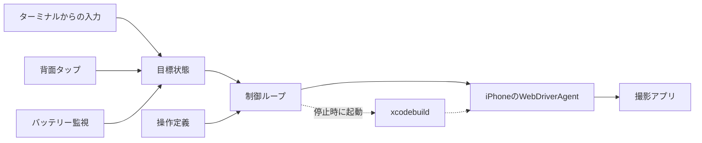

# アーキテクチャ

`field-app`がiPhoneを操作する仕組みを、ソースコードを読む前に把握するためのドキュメントです。コードの構成は[Controller Core](../mac/controller-core/README.md)を参照してください。

## 全体構成

Mac上で、iPhone 1台につき1つの`field-app`プロセスを実行します。`field-app`は、iPhone上のWebDriverAgentとHTTPで通信し、UI要素の取得とタップを行います。WebDriverAgentは、AppleのUIテストフレームワーク（XCUITest）上で動作するHTTPサーバーで、`field-app`がMacの`xcodebuild`を使って起動します。

1台のiPhoneを操作するのは、そのiPhoneに対応する`field-app`のみです。1台が停止しても、他のiPhoneの`field-app`は動作を継続します。

## 指示と目標状態

`field-app`への指示は、撮影継続（`running`）または停止（`paused`）の目標状態として保持します。指示の送信元は次の3つで、いずれも同じ目標状態を更新します。新しい指示を受信すると、前の指示は上書きされます。

- ターミナルからの入力
- 背面タップのショートカットからのHTTPリクエスト
- バッテリー監視。充電していない状態でバッテリー残量が設定値まで低下すると、停止の指示を出す

起動直後は目標状態を持たず、最初の指示を受信するまでは画面の読み取りだけを行います。停止状態に到達した後も、次の指示を受信するまでは画面の読み取りだけを行うため、休憩中に作業者がiPhoneを操作しても干渉しません。

目標状態は、変更のたびにMacのディスクに保存します。撮影継続中に`field-app`が異常終了した場合は、再起動した`field-app`がこれを引き継ぎます。正常終了時は停止状態まで遷移してから`paused`を保存するため、次回起動時には引き継ぎません。

## 操作定義

操作定義は、撮影アプリごとの画面遷移を記述したJSONです。

- 状態: 画面の識別条件。存在すべきUI要素と、存在してはならないUI要素
- 操作: どの状態で、どのボタンをタップすると、どの状態に遷移するか
- 自動遷移: カウントダウン終了後に録画中になる、など、アプリが自ら行う遷移
- 目標状態: 撮影継続と停止のそれぞれで到達すべき状態

UI要素は、アプリが設定しているアクセシビリティ識別子で特定します。書式は[操作定義の形式](app-operation-format.md)を参照してください。

## 制御ループ

`field-app`は、次の処理を繰り返します。

1. 画面を読み取り、操作定義のどの状態に該当するかを1つに特定する
2. 現在の状態から目標状態までの最短経路を操作定義から計算し、次の操作を決定する
3. 次の操作を実行する。タップした場合は、画面が遷移するまで最大約8秒待機する

操作のたびに画面を読み取り直して経路を再計算するため、作業者が途中で画面に触れても、次の操作は触れた後の画面から決定されます。

読み取った画面は、次の5種類のいずれかに分類され、それぞれ次の操作が決まります。

| 読み取った画面 | 次の操作 |
| --- | --- |
| 操作定義の状態 | 目標状態であれば何もしない。そうでなければ、経路の最初の操作（タップ、またはアプリの自動遷移の待機） |
| iOSのアラート | 操作定義に記述されたアラートであれば、指定のボタンで閉じる。記述がなければ停止する |
| ロック画面 | ロックを解除する。パスコードが設定されていて解除できなければ停止する |
| 撮影アプリ以外が前面 | 撮影アプリを前面に戻す。終了していれば起動する |
| 未定義の画面 | 操作定義で許可されていれば、撮影アプリを再起動する。許可されていなければ停止する |

前面のアプリは、画面中央に表示されているアプリで判定します。ホーム画面、他のアプリ、コントロールセンター、Appスイッチャーが表示されている場合は、撮影アプリが前面にないと判定し、撮影アプリを前面に戻します。この操作により、システムの画面は閉じられます。

タップ後に画面が遷移しなかった場合は、アプリがタップを取りこぼしたとみなし、画面を読み取り直して次の操作を決定し直します。1つの目標状態に対して12回読み取っても到達しない場合は、停止します。

画面の読み取り間隔は、状況に応じて変わります。録画中や停止後など画面が変化しない間は10秒ごと、カウントダウンなどアプリの自動遷移を待つ間は1秒ごと、再接続中は2秒ごとです。指示を受信した場合は、即座に読み取ります。1回の問い合わせで取得するのはUI要素の名前と種類のみで、画面が変化しない間の通信は1分あたり約7回（画面6回、バッテリー1回）です。

## 未定義の画面

次の画面を、未定義の画面として扱います。

- 操作定義のどの状態にも該当しない、または2つ以上の状態に該当する画面
- 状態には該当するが、タップしようとしたボタンが、操作定義にないシートやダイアログに覆われている画面。覆われていてもボタンは読み取れるため、タップの直前にタップ可能かどうかを確認して判別する

未定義の画面では、タップを行いません。操作定義の`recovery`で許可されていれば、撮影アプリを再起動し、定義済みの画面から経路を再計算します。再起動すると録画データが失われる画面（Minuteでは録画画面）は、操作定義に識別用の要素を記述しておき、その画面では再起動せずに停止します。再起動は1回の制御ループにつき1回までで、再起動後も未定義の画面のままであれば停止します。

## 停止条件

次の場合は、タップを行わずに停止します（要対応状態）。ログには`needs attention`と出力されます。

- 未定義の画面で、再起動が許可されていない、録画画面である、または再起動後も未定義の画面のまま
- 操作定義に記述のないiOSのアラートが表示されている
- タップ対象のボタンが見つからない、または同じ識別条件のボタンが2つ以上ある
- iPhoneが操作を拒否した
- ロックを解除できない
- 現在の状態から目標状態への経路がない
- 12回読み取っても目標状態に到達しない

停止後は、新しい指示（背面タップを含む）またはターミナルの`retry`で再開します。再開時は、画面を読み取り直して次の操作を決定します。

## 接続断と再接続

WebDriverAgentに接続できない場合や、WebDriverAgentとのセッションが失われた場合は、10秒間隔で再接続を試みます。ログには`reconnecting`と出力されます。撮影アプリは、Macとの接続状態に関係なく録画を継続します。

再接続時は、まず`devicectl`でiPhoneに到達できるかを確認します。iPhoneに到達できるにもかかわらずWebDriverAgentが応答しない場合に限り、`xcodebuild`でWebDriverAgentを再起動します。iPhoneがWi-Fiの範囲外にある間は、再起動せずに復帰を待ちます。3回再起動しても応答がない場合は、署名の期限切れなどとみなし、Xcodeの出力をログに出力して停止します。

タップの直後に応答が途絶えた場合は、そのタップが届いたかどうかを判別できません。同じボタンを再度タップせず、再接続後に画面を読み取って次の操作を決定します。タップが届いていれば画面は遷移しているため、二重にタップすることはありません。

## 背面タップ

装着者（iPhoneを頭部に装着して作業する人）は、iPhoneの背面をトリプルタップすると撮影を開始し、ダブルタップすると停止します。背面タップに割り当てたショートカットが、効果音を再生した後、`field-app`にHTTPのPOSTリクエストで指示を送信し、応答文を読み上げます。

`field-app`は、指示を受信すると即座に「撮影を開始します。」または「撮影を終了します。」と応答します。この応答は、`field-app`が指示を受信したことを示します。録画の開始と停止は、応答の後に`field-app`が画面を読み取りながら進めます。`field-app`が指示を受け付けなかった場合は、応答文が空になり、ショートカットは「親機に接続できません。親機に近づいて、しばらく待ってからもう一度タップしてください。」と読み上げます。リクエストにはiPhoneごとのトークンが必要なため、同じネットワーク上の他の端末からは指示を送信できません。

## バッテリー監視

`field-app`は、1分ごとにiPhoneのバッテリー残量と充電状態を取得します。充電していない状態でバッテリー残量が設定値（既定は10%）まで低下すると、停止の指示を出し、Macに通知を表示します。

## 終了処理

ターミナルの`quit`、Ctrl-C、終了シグナルの受信、ターミナルの終了は、いずれも同じ手順で終了します。目標状態を停止に変更し、実行中の操作の完了を待ってから、停止状態まで遷移して終了します。要対応状態や接続断の状態ではタップを行わずに終了し、停止状態を確認できなかったことをログに出力して、終了コード1を返します。

## WebDriverAgentとの接続

- iPhoneの接続先は、XcodeがiPhoneとの間に確立している経路のアドレスを`devicectl`で取得して使用する。Wi-FiでもUSBでも同じ方法で接続でき、すべてのiPhoneのWebDriverAgentは同じポートで待ち受ける
- WebDriverAgentは、`field-app`の終了後も動作を継続し、次に起動した`field-app`がそのまま使用する。`field-app`を再起動しても撮影アプリは操作しないため、録画は中断されない
- セッションの作成時に撮影アプリを指定せず、画面中央のアプリをWebDriverAgentに読み取らせる。撮影アプリを指定すると、コントロールセンターが開いていても背後の撮影アプリを読み取ってボタンをタップ可能と返すため、タップがコントロールセンターに当たる
- WebDriverAgentの、アプリの画面が安定するまで待機する機能を無効にする。撮影アプリは録画中に画面を描画し続けるため、待機すると1回のタップに20秒かかる。画面の安定は、`field-app`が同じ画面を2回続けて読み取れたかどうかで判定する
- WebDriverAgentは`tools/setup_wda.sh`でビルドする。バージョンとチェックサムはスクリプト内で固定している

## 今後の予定

複数台を一括管理するMacアプリ（Controller）は、実機での動作確認が完了してから開発します。iPhoneの登録、`field-app`の起動と停止、状態の表示、一括での開始と停止を担う予定です。それまでは、`field-app`の起動と再起動をmacOSのlaunchdが担い、状態は`field-app`ごとのログで確認します。

AIエージェントは、アプリのアップデートで画面が変わった際に、UI要素を調査して操作定義を修正する作業の支援に使用します。運用中の判断は、操作定義と上記の制御ループのみで行います。
