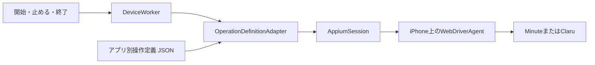

# アーキテクチャ

## 構成

Mac上では、iPhoneごとに一つの`field-app`プロセスを起動します。各プロセスは、そのiPhoneのAppiumセッション、Device Worker、アプリ別操作定義を一つずつ持ちます。

開始・止める・終了の指示は、`running`または`paused`という目標状態を書き換えるだけで、タップには直接変えません。Device Workerは、画面を読み取るたびに今の状態と目標状態から次の一歩を決めます。

## 1回の判断

Device Workerは、次の流れを繰り返します。CLIは0.5秒ごとにこの流れを呼び、画面の変化と指示の変化をとらえます。

1. 画面を読む。操作定義のすべての目印を一度の問い合わせで読み、当てはまる状態を一つに決める。0.3秒あけて2回続けて同じ結果になるまで読み直す
2. 次の一歩を決める。今の状態が目標なら何もしない。そうでなければ、許された操作とアプリの移り変わりから目標までのいちばん軽い道順を計算し、その最初の一歩を選ぶ
3. 一歩進む。最初の一歩が待つことなら、何もせずに次の読み取りを待つ。押すことなら、押して、画面が変わるのを約8秒まで待つ

画面が変わらなければ、アプリがタップを取りこぼしたとみなし、次の読み取りから道順を決め直します。一つの目標に向かう読み取りは12回までで、それを超えたら止めて人を待ちます。目標が途中で変われば数え直します。

## 押さずに止まるとき

次のときは押さずに`needsAttention`になり、人が画面を確かめて`retry`するまで操作しません。

- 読み取った画面にどの状態も当てはまらない、または二つ以上当てはまる
- iOSのダイアログ（権限の確認など）が出ている
- 押す部品が見つからない、二つ以上ある、または何かに覆われて押せない
- タップの返事が通信の途中で失われた
- 今の状態から目標への道順がない
- 12回読み取っても目標に着かない

対象アプリが前面にないときは、アプリを前面に戻してから続けます。

## 終了

`quit`、入力の終わり、Ctrl-C、終了要求、ターミナルを閉じたときは、どれも同じ終了の流れに入ります。目標を`paused`にし、送信済みの操作が終わるのを待ってから、止めた状態まで進めて終わります。`needsAttention`のときはタップせずに終わり、止めた状態を確かめられなかったことを表示して終了コード1を返します。

## Appiumとの接続

- 接続を作るときにアプリを起動し直さない。録画中に接続を作り直しても、撮影が途切れない
- アプリが落ち着くのを待つWebDriverAgentの機能を切る。撮影アプリは常に画面を動かしているため、待つと1タップに20秒かかる。画面が落ち着いたかは、上の読み取りで判断する
- 要素の検索で接続が切れていたら、一度だけ接続を作り直して読み直す
- 端末ごとにWebDriverAgentのポートとビルドの置き場所を分ける

## 複数台の管理

複数台をまとめるControllerは、次の責務を持つ上位の管理機能として追加します。

- 登録端末、対象アプリ、操作定義の割り当て
- 端末ごとの`field-app`プロセスの起動と停止
- 状態、経過時間、要対応状態の表示
- 全体または個別の開始・止める・再試行

## エージェントの位置づけ

AIエージェントは制御ループの外側に置きます。アプリの更新で画面が変わったときに画面の部品を調べ、操作定義を直す支援には使いますが、通常運転中に未知の画面を推測して押しません。

## 配布

開発中はSwift Packageの`field-app`実行ファイルを使用します。二台同時運転、Wi-Fi切断からの復旧、8時間連続運転を確認した後、同じ実行器を署名・公証したMacアプリへ包みます。

MacアプリのDeveloper ID署名と、iPhone上のWebDriverAgentに必要なApple Development署名は別に管理します。端末UDIDとTeam IDは実行時の環境変数で、撮るタスクはローカルの操作定義で与えます。
