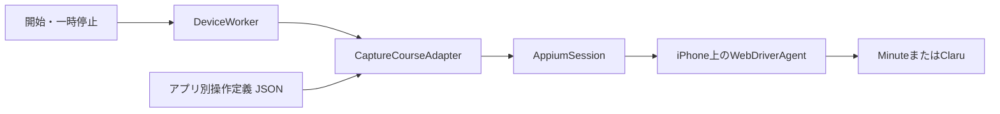

# アーキテクチャ

## 通常フロー

Mac上では、iPhoneごとに一つのDevice Workerと一つのAppiumセッションを起動します。各端末にMinuteまたはClaruの操作定義を割り当て、同じ共通処理で実行します。



操作定義は、対象アプリ、画面判定条件、操作対象、状態遷移を記述するデータです。実行時には`CaptureCourseAdapter`が定義を参照して画面を判定し、現在画面と目標状態に対応する操作を選びます。

ユーザーの開始・一時停止は、端末ごとの`running`または`paused`という目標状態を更新します。Device Workerは`CaptureAppAdapter`インターフェースを通じて画面の観測、次の操作の選択、実行を一つずつ進めます。タップは`AppiumSession`を経由して対象端末へ送ります。

## 責務

### 操作受付と端末管理

現在は共通の`field-app` CLIを一台につき一プロセス起動し、`--course`で操作定義のJSONを指定します。CLIは端末への接続とワーカーの起動を行い、開始・一時停止・状態確認・再試行・終了を受け付けます。

複数端末をまとめるControllerは、次の責務を持つ上位の管理機能として追加します。

- 登録端末、対象アプリ、操作定義の割り当て
- 端末ごとのワーカープロセス起動・停止
- 状態、経過時間、再開回数、要対応状態の表示
- 全体または個別の開始・一時停止・再試行
- UI、CLI、物理入力から来た目標状態の統合

### Device Worker

- 一台分の操作を直列化する
- 最新の目標状態だけを保持する
- 未知画面や操作の失敗を`needsAttention`へ移す
- ユーザー入力と定期観測が重なっても二つの操作を同時送信しない
- 遷移の上限は目標状態ごとに数え、途中で目標が変わったら数え直す
- 終了時は目標を`paused`にし、送信済みの操作が終わるのを待ってから一時停止まで進めて止める。`needsAttention`ならタップせずに止める

### Appium session

- 実機上のWebDriverAgentを起動または再利用する
- 端末ごとに別のWDA・MJPEGポートを使う
- accessibility identifierまたは検証済みidentifier prefixで要素を検索する
- 要素IDを指定してタップする
- 観測時のセッション切断だけを一度再接続する
- 結果不明のタップを自動再送しない

### 操作定義の実行

`CaptureCourseAdapter`は、`CaptureAppAdapter`の共通実装です。`CaptureCourseDefinition`として読み込んだJSONの操作定義に従って、次の処理を行います。

- 操作定義に登録されたblockerを先に探す
- 四つの画面証明のうち一つだけが成立することを確認する
- `running`または`paused`と現在画面に対応する遷移を一つ選ぶ
- 操作対象が一つだけ存在することを確認してタップする
- `stable`では何もせず、`needsOperator`では停止する

### アプリ別操作定義

`apps/<app-name>/course.example.json`には、次の項目を持つ定義例を置きます。実行時は、この例から作成した`config/local/`内の設定ファイルを読み込みます。

- bundle identifier
- `home`、`taskReady`、`recording`、`completionPending`を証明する要素
- `open-task`、`start-recording`、`stop-recording`、`discard-recording`などの操作
- 各操作がnavigation、録画開始、録画停止、削除、提出のどれか
- 目標状態と現在画面の組ごとの遷移
- ログイン、権限、警告を検出するblocker

MinuteとClaruは同じ定義形式を使います。現在の形式は四つの画面状態とタップ操作を扱います。アプリ追加時もDevice WorkerとAppium接続を共用し、実際の操作手順がこの形式で表せない場合に、必要な処理と定義項目を拡張します。

## 画面の流れの例

`apps/`の操作定義例は、次の流れを想定しています。

```text
home ── open-task ──> taskReady
taskReady ── start-recording ──> recording
recording ── 自然終了または stop-recording ──> completionPending
completionPending ── 完了後の操作 ──> home
```

目標が`running`なら、`home`に戻るたびに次のチャンクを開始します。目標が`paused`なら、`home`で待機します。完了後の操作は操作定義で選びます。提出や破棄の操作を割り当てることも、`needsOperator`にしてタップせず人の確認を待つこともできます。

JSONの`transitions`には、現在画面と目標状態の組ごとに次の操作だけを書きます。操作後の画面は上図から推測せず、再観測で判定します。時間だけから録画状態を推定することもしません。画面証明や操作対象が0件または複数件の場合は操作しません。

## エージェントの位置づけ

AIエージェントは制御ループの外側に置きます。アプリ更新後の画面要素を調べ、MinuteやClaruの操作定義を修正する支援には使えますが、通常運転中に未知の画面を推測してタップしません。

## 配布

開発中はSwift Packageの`field-app`実行ファイルを使用します。MinuteとClaruの実画面、二台同時運転、Wi-Fi切断復旧、8時間連続運転を確認した後、同じ実行器を署名・公証したMacアプリへ包みます。

MacアプリのDeveloper ID署名と、iPhone上のWebDriverAgentに必要なApple Development署名は別に管理します。端末UDIDとTeam IDは実行時の環境変数で、対象タスクはローカルの操作定義で与えます。
