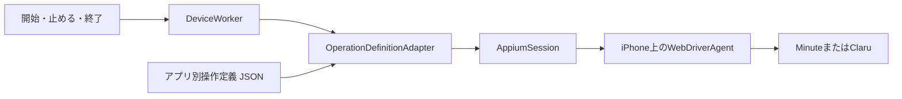

# アーキテクチャ

## 構成

Mac上では、iPhoneごとに一つの`field-app`プロセスを起動します。各プロセスは、そのiPhoneのAppiumセッション、Device Worker、アプリ別操作定義を一つずつ持ちます。

開始・止める・終了の指示は、`running`または`paused`という目標状態を書き換えるだけで、タップには直接変えません。Device Workerは、画面を読み取るたびに今の状態と目標状態から次の一歩を決めます。

指示の出どころは次のとおりです。どれも同じ目標状態を書き換えます。

- ターミナルへの入力
- 背面タップのショートカットからのHTTP要求（`FAO_CONTROL_PORT`）
- 電池の見張り。充電していない状態で残りが10%（`FAO_BATTERY_STOP_PERCENT`で変更）になると、止める指示を出してMacに通知する

## 1回の判断

Device Workerは、次の流れを繰り返します。

1. 画面を読む。操作定義のすべての目印を一度の問い合わせで読み、当てはまる状態を一つに決める。どの状態にも当てはまらないときだけ、前面のアプリ、ロック、iOSの警告を順に確かめる。前回と同じ結果ならそれで決まり。違えば、0.3秒あけて2回続けて同じ結果になるまで読み直す
2. 読み取った画面から、次の一歩を一つ決める（下の表）
3. 一歩進む。待つことなら、何もせずに次の読み取りを待つ。それ以外なら実行し、画面が変わるのを約8秒まで待つ

画面が変わらなければ、アプリがタップを取りこぼしたとみなし、次の読み取りから道順を決め直します。押そうとした部品が押す前や押す瞬間に消えていた場合も、画面がすでに先へ進んだとみなし、読み直して次の一歩を決めます。一つの目標に向かう読み取りは12回までで、それを超えたら止めて人を待ちます。目標が途中で変われば数え直します。

次に画面を読むまでの間隔は、Device Workerの状態で決まります。録画中や止めた状態のように落ち着いているときは10秒、カウントダウンのようにアプリが自分で進むのを待つときは1秒、つなぎ直しの間は2秒です。指示が届いたときは待たずにすぐ読みます。画像は送らず、やり取りは部品の名前の問い合わせだけなので、落ち着いている間の通信は1分に7回ほど（画面6回、電池1回）です。

起動した直後は目標状態がなく、最初の指示が来るまで画面を読むだけで何も押しません。止める状態に着いた後も、次の指示が来るまで何も押しません。休憩中に人がiPhoneを使っても、止めた状態へ連れ戻しません。

## 読み取った画面と次の一歩

読み取った画面は次の五つのどれかで、それぞれ次の一歩が決まっています。

| 読み取った画面 | 次の一歩 |
| --- | --- |
| 操作定義の状態 | 目標なら何もしない。目標でなければ、道順の最初の一歩（押す、またはアプリが進むのを待つ） |
| iOSの警告 | 操作定義に書いた警告なら、書いたボタンで閉じる。書いていなければ人を待つ |
| ロック画面 | 解除する。解除できなければ人を待つ |
| 対象アプリ以外が前面にある | 対象アプリを前面に戻す |
| 知らない画面 | 操作定義が許せば、アプリを起動し直す。許さなければ人を待つ |

## 対象アプリが前面にないとき

前面のアプリは、画面の中央にあるアプリで判断します。ほかのアプリやホーム画面のほか、コントロールセンター、通知センター、アプリの切り替え画面が開いているときも、対象アプリは前面にないと判断し、アプリを前面に戻してから続けます。これらのシステムの画面は、アプリを前面に戻すと閉じます。アプリが終了されていれば、前面に戻す操作で起動します。

ロック画面とiOSの警告も画面の中央を覆うので、対象アプリが前面にないときにだけ確かめます。ロックされていれば解除します。警告は文を読み、操作定義の`systemAlerts`に書いた警告なら、書いたボタンで閉じます。ボタンを押す直前にも警告が出ていないかを確かめ、出ていればその押す操作をやめて、先に警告を扱います。対象アプリの部品は警告の下でも押せるように見えますが、押すと警告のボタンに当たるからです。

## 知らない画面から戻る

次の画面は、操作定義が知らない画面です。

- どの状態にも当てはまらない、または二つ以上の状態に当てはまる
- 状態には当てはまるが、押す部品が定義にないシートやダイアログに覆われている。覆われていても下の部品は読み取れるので、押す前に押せるかどうかを確かめて見分ける

知らない画面のボタンは押しません。操作定義の`recovery`が許していれば、アプリを起動し直し、知っている画面から道順を決め直します。起動し直すと撮ったものが失われる画面は、操作定義の`relaunchUnless`に目印があり、そこでは起動し直しません。起動し直すのは1回の判断の流れで一度だけです。起動し直しても知らない画面のままなら、人を待ちます。

## 押さずに止まるとき

次のときは押さずに`needsAttention`になり、人が画面を確かめて`retry`するまで操作しません。

- 知らない画面で、操作定義が起動し直しを許していない、そこが起動し直さない画面である、または起動し直しても知っている画面に戻らない
- 操作定義に書いていないiOSの警告（権限の確認など）が出ている、または書いたボタンが警告にない
- 押す部品が見つからない、または二つ以上ある
- iPhoneがコマンドを断った
- iPhoneがロックされていて、解除できない（パスコードが設定されている）
- 今の状態から目標への道順がない
- 12回読み取っても目標に着かない

`retry`のほか、新しい指示（背面タップを含む）も、人が確かめた合図として待ちを終えます。どちらの場合も、次の一歩は新しい読み取りから決めます。

## 接続が切れたとき

Appiumに届かない、AppiumがWebDriverAgentにつながらない、セッションがなくなった、という失敗では、そのセッションを捨て、10秒おきに作り直します。その間は`reconnecting`となり、人を待ちません。Wi-FiやUSBの切断、Appiumの停止、WebDriverAgentRunnerの終了、音量ボタンの同時押しによる自動操作の中断は、どれもこの扱いです。対象アプリはMacと関係なく録画を続けます。

iPhoneからの返事のうち、部品がもう画面にない、警告が開いていない、というものは、セッションが動いている証拠なので、セッションを捨てずに画面を読み直します。それ以外の断りの返事（押すはずのボタンがないなど）も接続の失敗ではありません。つなぎ直しても同じ返事が続くだけなので、人を待ちます。

タップの返事が途中で失われた場合も、そのタップが届いたかはわかりません。同じタップを再送せず、つながった後の読み取りから次の一歩を決めます。届いていれば画面が進んでいるので、二重には押しません。

## 終了

`quit`、入力の終わり、Ctrl-C、終了要求、ターミナルを閉じたときは、どれも同じ終了の流れに入ります。目標を`paused`にし、送信済みの操作が終わるのを待ってから、止めた状態まで進めて終わります。`needsAttention`のときやつながっていないときはタップせずに終わり、止めた状態を確かめられなかったことを表示して終了コード1を返します。

## Appiumとの接続

- セッションに対象アプリを指定しない。接続を作るときも終えるときもアプリを起動し直さないので、録画中に接続を作り直しても撮影が途切れない。WebDriverAgentは画面の中央にあるアプリを読む。対象アプリを指定すると、コントロールセンターが開いていても下のアプリを読み、部品を押せるものとして返すので、タップがコントロールセンターに当たる
- アプリが落ち着くのを待つWebDriverAgentの機能を切る。撮影アプリは常に画面を動かしているため、待つと1タップに20秒かかる。画面が落ち着いたかは、上の読み取りで判断する
- 端末ごとにWebDriverAgentのポートとビルドの置き場所を分ける

## 複数台の管理

複数台をまとめるControllerは、次の責務を持つ上位の管理機能として追加します。

- 登録端末、対象アプリ、操作定義の割り当て
- 端末ごとの`field-app`プロセスの起動と停止
- 状態、経過時間、要対応状態の表示
- 全体または個別の開始・止める・再試行

## エージェントの位置づけ

AIエージェントは制御ループの外側に置きます。アプリの更新で画面が変わったときに画面の部品を調べ、操作定義を直す支援には使いますが、通常運転中に未知の画面を推測して押しません。

## 配布

開発中はSwift Packageの`field-app`実行ファイルを使用します。二台同時運転、Wi-Fi切断からの復旧、8時間連続運転を確認した後、同じ実行器を署名・公証したMacアプリへ包みます。

MacアプリのDeveloper ID署名と、iPhone上のWebDriverAgentに必要なApple Development署名は別に管理します。端末UDIDとTeam IDは実行時の環境変数で、撮るタスクはローカルの操作定義で与えます。
